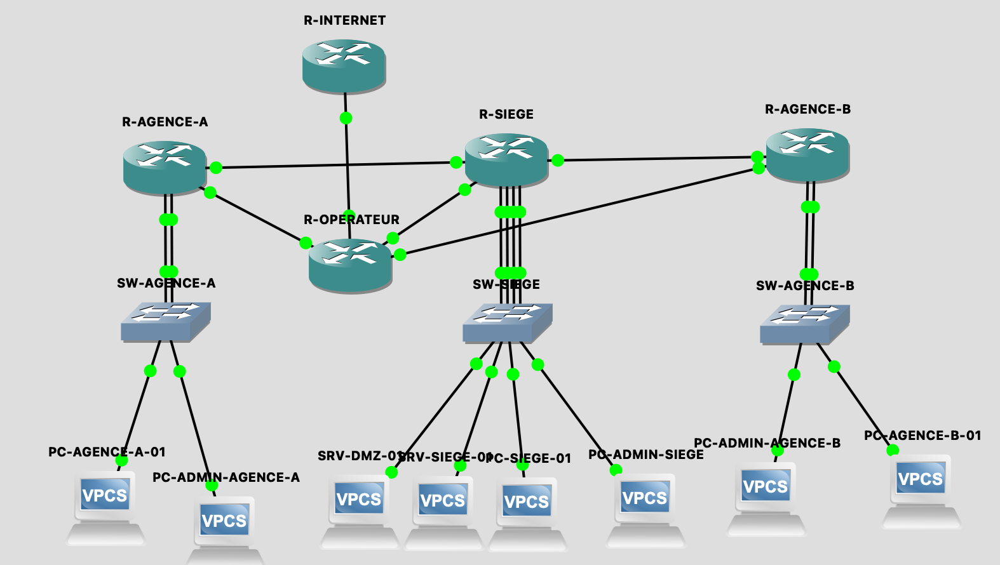

# projet-reseau-multisites
Infrastructure réseau multi-sites sécurisée avec GNS3

## Présentation du projet

Ce projet consiste à concevoir, déployer et sécuriser une infrastructure réseau d'entreprise multisite à l'aide de **GNS3** et de routeurs Cisco 7200.

L'infrastructure représente une entreprise composée d'un siège social et de deux agences distantes. Les différents sites communiquent à travers un réseau opérateur simulé.

L'objectif est de mettre en œuvre une architecture réseau structurée, évolutive et sécurisée, en intégrant les principaux mécanismes utilisés dans les infrastructures d'entreprise.

Ce projet a été réalisé dans une démarche de mise en pratique des compétences en administration réseau, routage, segmentation, sécurité et dépannage.

## Topologie du projet dans GNS3



## Objectifs techniques

- Concevoir une architecture réseau multisite.
- Segmenter les réseaux à l'aide de VLAN.
- Mettre en place le routage inter-VLAN.
- Déployer un service DHCP.
- Configurer OSPF pour le routage interne.
- Configurer eBGP pour les échanges de routes avec un opérateur.
- Mettre en place une traduction d'adresses NAT/PAT.
- Sécuriser les communications avec des ACL.
- Isoler une zone DMZ.
- Déployer des VPN IPsec site-à-site.
- Tester la connectivité et la résilience de l'infrastructure.
- Documenter et sauvegarder les configurations.

## Architecture réseau

L'infrastructure repose sur trois sites :

| Site | Équipements | Fonction |
|---|---|---|
| Siège social | R-SIEGE, SW-SIEGE | Site central |
| Agence A | R-AGENCE-A, SW-AGENCE-A | Site distant |
| Agence B | R-AGENCE-B, SW-AGENCE-B | Site distant |
| Opérateur | R-OPERATEUR | Interconnexion des sites |
| Internet simulé | R-INTERNET | Simulation d'une destination Internet |

Le siège constitue le point central de l'architecture. Les deux agences disposent de liaisons vers le siège et vers le routeur opérateur.

Les tunnels VPN IPsec sont établis entre le siège et chacune des agences.

## Plan d'adressage IP et segmentation

Chaque site dispose de plusieurs réseaux logiques indépendants.

### Siège social

| VLAN | Nom | Réseau | Passerelle |
|---|---|---|---|
| 10 | Utilisateurs | 192.168.10.0/24 | 192.168.10.1 |
| 20 | Serveurs | 192.168.20.0/24 | 192.168.20.1 |
| 30 | Administration | 192.168.30.0/24 | 192.168.30.1 |
| 40 | DMZ | 192.168.40.0/24 | 192.168.40.1 |

### Agence A

| VLAN | Nom | Réseau | Passerelle |
|---|---|---|---|
| 110 | Utilisateurs | 192.168.110.0/24 | 192.168.110.1 |
| 120 | Administration | 192.168.120.0/24 | 192.168.120.1 |

### Agence B

| VLAN | Nom | Réseau | Passerelle |
|---|---|---|---|
| 210 | Utilisateurs | 192.168.210.0/24 | 192.168.210.1 |
| 220 | Administration | 192.168.220.0/24 | 192.168.220.1 |

Le routage inter-VLAN est assuré par des interfaces physiques dédiées sur les routeurs Cisco.

### Liaisons WAN privées

| Liaison | Réseau | Adresse du premier routeur | Adresse du second routeur |
|---|---|---|---|
| Siège – Agence A | 10.0.0.0/30 | Siège : 10.0.0.1 | Agence A : 10.0.0.2 |
| Siège – Agence B | 10.0.0.4/30 | Siège : 10.0.0.5 | Agence B : 10.0.0.6 |

Les interconnexions avec le réseau opérateur utilisent également des sous-réseaux dédiés en /30.

## Technologies et fonctionnalités mises en œuvre

### 1. Segmentation réseau et routage inter-VLAN

Création de huit réseaux logiques répartis sur les trois sites.

Chaque réseau dispose de sa propre passerelle sur le routeur du site.

Cette organisation permet de séparer les utilisateurs, les serveurs, l'administration et la DMZ, et de contrôler les communications entre les différents segments.

### 2. DHCP

Configuration de serveurs DHCP directement sur les routeurs Cisco.

Les pools DHCP comprennent :
- Une plage d'adresses dédiée à chaque réseau.
- Une passerelle par défaut.
- Un serveur DNS.
- Des plages d'adresses réservées pour les équipements à configuration statique.

Les configurations DHCP ont été réalisées et sauvegardées. La validation complète de l'attribution automatique sur les clients VPCS reste à approfondir en raison de difficultés rencontrées avec le client DHCP de simulation.

### 3. Routage dynamique OSPF

Déploiement d'OSPF (process ID 1, area 0) pour assurer le routage interne entre le siège et les agences.

Travaux réalisés :
- Configuration des réseaux annoncés.
- Établissement des voisinages OSPF.
- Vérification des états de voisinage.
- Vérification des routes apprises.
- Remplacement du routage statique initial par OSPF pour les réseaux internes.
- Tests de communication entre les différents sites.

### 4. Routage eBGP avec un opérateur

Mise en place d'une architecture BGP à trois systèmes autonomes pour simuler l'interconnexion avec un fournisseur de services réseau.

| Équipement | AS |
|---|---|
| R-OPERATEUR | 65000 |
| R-SIEGE | 65010 |
| R-AGENCE-A | 65020 |
| R-AGENCE-B | 65030 |

Travaux réalisés :
- Configuration des sessions eBGP.
- Établissement des voisinages BGP.
- Annonce des réseaux LAN de chaque site.
- Vérification des préfixes reçus et annoncés.
- Tests de communication entre les sites via le réseau opérateur.

### 5. NAT/PAT et simulation Internet

Configuration du NAT/PAT sur R-OPERATEUR afin de permettre aux réseaux privés d'utiliser une adresse publique de sortie commune.

Fonctionnalités mises en place :
- Définition des interfaces NAT inside et NAT outside.
- Création d'une ACL identifiant les réseaux privés autorisés.
- Configuration du PAT avec surcharge d'adresse (overload).
- Configuration d'une destination Internet simulée sur R-INTERNET.

Les tests de connectivité vers l'adresse 198.51.100.1 ont été réalisés depuis les trois sites.

Les traductions ont été vérifiées avec la commande `show ip nat translations`.

### 6. Sécurité réseau avec ACL

Mise en place de listes de contrôle d'accès pour limiter les communications entre les différents segments.

| ACL | Routeur | Politique de sécurité |
|---|---|---|
| 101 | R-SIEGE | Bloquer les utilisateurs du siège vers le réseau Administration |
| 102 | R-SIEGE | Limiter les communications initiées depuis la DMZ vers les réseaux internes |
| 103 | R-SIEGE | Empêcher les utilisateurs des agences d'accéder au réseau Administration du siège |
| 110 | R-AGENCE-A | Isoler les utilisateurs de l'administration de l'agence A |
| 2010 | R-AGENCE-B | Isoler les utilisateurs de l'administration de l'agence B |

Les ACL ont été appliquées sur les interfaces concernées et testées à l'aide de communications ICMP.

La DMZ est également isolée des principaux réseaux internes. Les exceptions ICMP nécessaires aux réponses aux tests ont été prises en compte.

**Remarque :** les ACL constituent ici un filtrage réseau stateless. Elles ne remplacent pas un pare-feu à inspection d'état.

### 7. VPN IPsec site-à-site

Déploiement de deux tunnels VPN IPsec avec le siège comme point central :

- Siège ↔ Agence A.
- Siège ↔ Agence B.

Paramètres cryptographiques utilisés :
- IKE Phase 1.
- AES-128.
- SHA.
- Authentification par clé prépartagée.
- Groupe Diffie-Hellman 5.
- ESP-AES.
- ESP-SHA-HMAC.

Les configurations comprennent :
- Les politiques ISAKMP.
- Les clés prépartagées.
- Les ACL définissant les flux à chiffrer.
- Les transform-sets.
- Les crypto maps.
- L'application des crypto maps sur les interfaces WAN.

Les états IKE et IPsec ont été contrôlés à l'aide des commandes :

```bash
show crypto isakmp sa
show crypto ipsec sa
```

Les compteurs d'encapsulation, de chiffrement, de décapsulation et de déchiffrement ont permis de valider le fonctionnement du premier tunnel. Les deux tunnels ont ensuite été configurés et testés.

Les clés utilisées sont des clés de laboratoire et ne sont pas destinées à un environnement de production.

## Tests et validation

Plusieurs campagnes de tests ont été effectuées afin de vérifier le bon fonctionnement de l'infrastructure.

| Test | Résultat |
|---|---|
| Connectivité entre postes d'un même réseau | Validé |
| Connectivité entre les passerelles LAN | Validé |
| Communication entre les trois sites | Validé |
| Voisinages OSPF | Validé |
| Établissement des sessions eBGP | Validé |
| Apprentissage des routes BGP | Validé |
| NAT/PAT depuis les trois sites | Validé |
| Blocage des flux interdits par ACL | Validé |
| Isolation des réseaux d'administration | Validé |
| Protection des réseaux internes par ACL DMZ | Validé |
| VPN IPsec siège – agence A | Validé |
| VPN IPsec siège – agence B | Validé |
| Tests de basculement WAN | Validé |
| Attribution DHCP automatique sur VPCS | À approfondir |

### Test de résilience WAN

Un test de panne a été réalisé sur la liaison directe entre le siège et l'agence A.

Déroulement :
1. Vérification de la connectivité initiale entre les deux sites.
2. Désactivation temporaire de la liaison WAN directe.
3. Vérification de la continuité des communications.
4. Contrôle de la table de routage du siège.
5. Identification de la route BGP via le routeur opérateur.
6. Rétablissement de la liaison directe.

La table de routage a confirmé l'utilisation du prochain saut 10.0.0.10, correspondant au routeur opérateur, avec une route apprise via eBGP.

Le même scénario de résilience a également été testé pour l'agence B.

## Environnement technique

| Composant | Technologie |
|---|---|
| Simulation réseau | GNS3 |
| Routeurs | Cisco 7200 |
| Systèmes d'exploitation réseau | Cisco IOS |
| Postes clients | VPCS |
| Commutation | Ethernet Switch intégré GNS3 |
| Routage interne | OSPF |
| Routage inter-AS | eBGP |
| VPN | IPsec |
| Sécurité | ACL Cisco |
| Traduction d'adresses | NAT/PAT |
| Version de l'environnement | macOS Ventura 13.7.8 |

**Précision sur la commutation :** les switches Ethernet intégrés à GNS3 ont été utilisés pour raccorder les équipements et affecter les ports aux réseaux correspondants. Le routage inter-VLAN est réalisé par interfaces physiques dédiées sur les routeurs ; cette simulation ne met pas en œuvre de trunks 802.1Q sur des commutateurs Cisco administrables.

## Compétences développées

Ce projet m'a permis de mettre en pratique les compétences suivantes :

**Réseaux**
- Conception d'une architecture multisite.
- Planification et gestion de l'adressage IPv4.
- Segmentation réseau.
- Routage inter-VLAN.
- Routage statique et dynamique.
- OSPF et eBGP.
- NAT et PAT.

**Cybersécurité**
- Filtrage des communications avec ACL.
- Segmentation des réseaux sensibles.
- Protection d'une DMZ.
- Mise en place de tunnels VPN IPsec.
- Contrôle des flux entre sites.

**Administration et dépannage**
- Configuration d'équipements Cisco IOS en CLI.
- Analyse des tables de routage.
- Vérification des voisinages et des associations de sécurité.
- Diagnostic des problèmes de connectivité.
- Tests de résilience.
- Sauvegarde des configurations.

**Virtualisation et documentation**
- Utilisation de GNS3.
- Construction et validation d'une topologie réseau.
- Organisation d'un projet technique.
- Gestion du projet et de sa documentation avec Git/GitHub.

## Arborescence du projet

## Améliorations envisageables

Plusieurs évolutions pourraient enrichir cette infrastructure :
- Remplacer les switches intégrés par de véritables switches Cisco prenant en charge les VLAN et les trunks 802.1Q.
- Ajouter un pare-feu dédié avec inspection stateful.
- Approfondir les tests DHCP sur les clients.
- Mettre en place une supervision réseau avec SNMP.
- Ajouter des mécanismes de haute disponibilité.
- Renforcer les politiques de sécurité VPN.
- Ajouter une documentation complète des configurations et des captures de validation.

## Conclusion

Ce projet m'a permis de concevoir et de mettre en œuvre une infrastructure réseau multisite simulant un environnement d'entreprise.

Il regroupe plusieurs technologies essentielles à l'administration des réseaux modernes : segmentation, routage dynamique, interconnexion opérateur, NAT/PAT, filtrage réseau et VPN IPsec.

La réalisation des tests de connectivité, de sécurité et de basculement m'a permis de mieux comprendre le fonctionnement des infrastructures multisites et les méthodes de diagnostic associées.

**Projet réalisé dans un objectif de montée en compétences en administration réseau et cybersécurité.**
